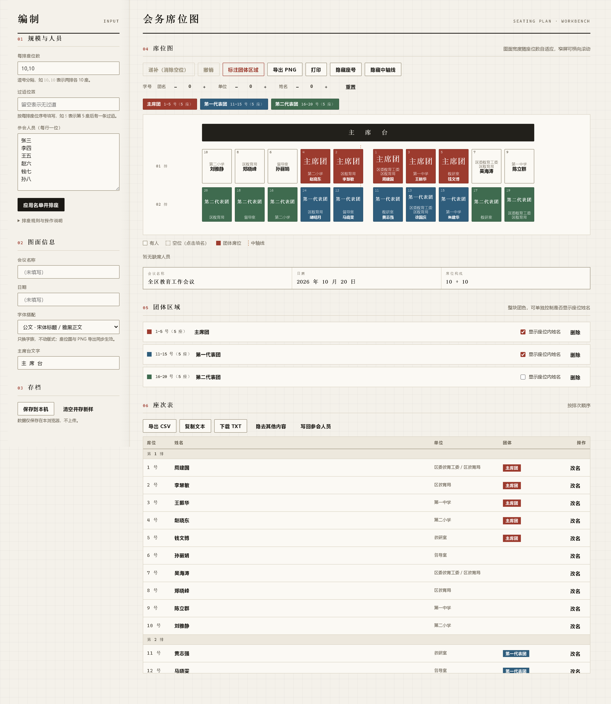
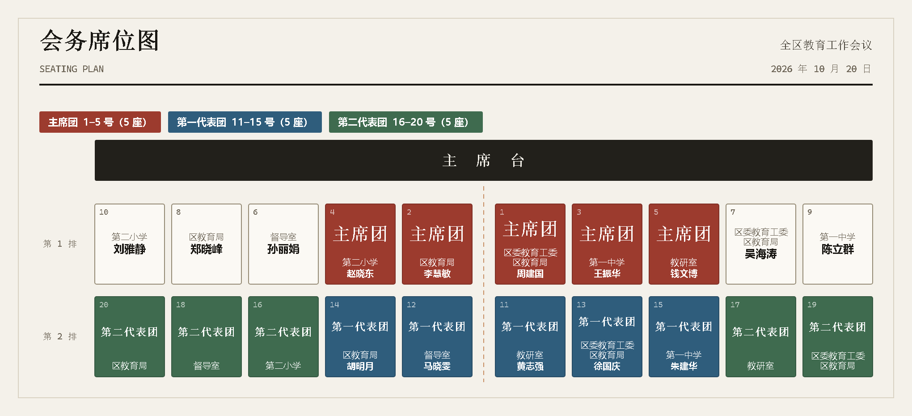
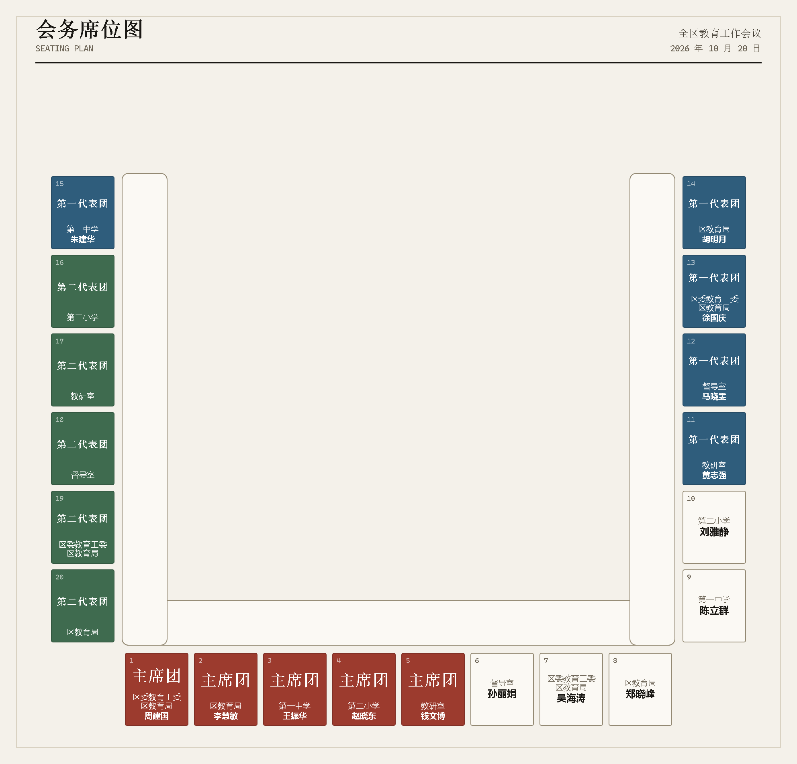
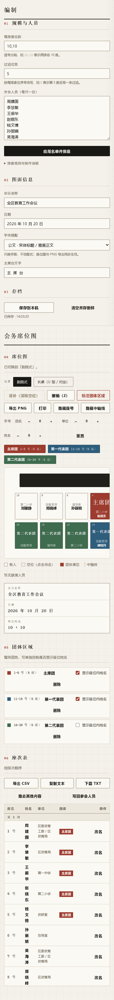

# 会务席位图 · 会议排座工具

**一个 HTML 文件就能用的排座工具。** 贴名单、拖座位、标团体，导出席位图或直接打印。
零依赖、不联网、数据只留在本机浏览器。

> 作者：宁波市第六医院 林恒屹




> 示例数据全部虚构，仅用于演示。

---

## 它解决什么问题

办会时排座位，Excel 画格子容易错位，手画一张又要反复改。这个工具把「排座 → 调格式 → 出图」放在一页里完成：

- **贴名单自动排座**：按「中心散开」的座次规则排布，1 号居中，左右交替。
- **拖拽即改**：交换两人 / 插到某人前面，松手生效，支持撤销。
- **团体区域**：框选座位、选色、写团名，主席台和代表团一眼分清。
- **出图干净**：打印和导出只保留已填内容——空位不写「空位」，没填的标题、操作按钮不进纸面。
- **座号 / 中轴线可隐藏**：需要极简版式时一键关掉，屏幕、打印、PNG 三处同步。
- **多种场景**：剧院式、长桌（U 型 / 对坐 / 回字），同一份名单切换布局不用重录。

## 快速开始

1. 下载 [`dist/会议辅助.html`](dist/会议辅助.html)（或 Release 附件里的单文件）；
2. 双击，用 Chrome / Edge / Safari / Firefox 打开；
3. 左栏贴名单 → **应用名单并排座** → 调规模与过道 → **导出 PNG** 或 **打印**。

不需要安装、不需要联网，也不会把名单上传到任何地方。

## 功能一览

| 想做的事 | 操作 |
|---|---|
| 换场景 | 顶部「场景」：剧院式 / 长桌（U 型、对坐、回字） |
| 长桌人数 | 上 / 下 / 左 / 右四条边各填人数，`0` 表示该边不坐人 |
| 改规模 | 左栏「每排座位数」填 `10,10`，回车 |
| 加过道 | 「过道位置」填 `5`（第 5 座后一条过道） |
| 排座 | 左栏贴名单 → 「应用名单并排座」 |
| 交换两人 | 把座位拖到另一个座位上 |
| 插入到某位置 | 拖到座位之间的空隙，松手后顺位后移 |
| 填名 / 改名 | 点空位填名；点座位左上 ✎ 改名 |
| 标记缺席 | 点有人座位；下方「缺席」标签点一下即插回原位 |
| 单位 | 点座位里的单位文字，Enter 换行（最多 3 行），Ctrl+Enter 保存 |
| 团体 | 「标注团体区域」→ 点选座位 → 选色 + 填团名 → 完成 |
| 字号 | 团名 / 单位 / 姓名 三组独立 −/+，PNG 同步 |
| 字体 | 「字体搭配」：公文（宋体标题 + 雅黑正文）/ 全宋 / 黑体 / 楷体 |
| 座号 | 「隐藏座号 / 显示座号」，图面与 PNG 同步 |
| 中轴线 | 「隐藏中轴线 / 显示中轴线」，图面与 PNG 同步 |
| 出图 | 「导出 PNG」（2 倍图）/「打印」（自动隐藏工具栏，只出图面与座次表） |
| 数据 | 「导出 CSV」Excel 可开；「复制文本」贴微信；「保存到本机」存浏览器 |

## 出图口径

- **PNG 2 倍图**：按 2 倍像素比绘制，投屏、打印都够清晰。
- **只画已填内容**：空座只留虚线框与座号；「空位」「（空）」「+ 单位」「（未填写）」这类占位不会出现在纸上。
- **单位在姓名之上**：单位通常更长，放在姓名上方不挤名字。
- **打印即交付**：`Ctrl+P` 自动隐藏左栏和工具栏，保留图面、座次表与标题栏。
- **开关同一份状态**：座号、中轴线由唯一状态位控制，DOM 与 Canvas 共用，屏幕和图片不会漂移。

导出的席位图示例（真实 PNG 输出，非截图）：



长桌（U 型）场景同样是一键导出：



移动端同样可用（拖拽走 Pointer Events，鼠标与触屏一套逻辑）：



## 键盘与无障碍

- 座位是 `role="button"` + `tabindex="0"`，方向键移动焦点，`Enter` 编辑，`Delete` 清空。
- 有明确的 `:focus-visible` 焦点环；正文对比度 15.7:1，注脚 5.0:1，团色白字 ≥ 5.3:1（WCAG AA）。

## 数据与隐私

- 全部运行在浏览器里：**无外部依赖、无网络请求、无 CDN、无统计埋点**。
- 存档写在 `localStorage`（键 `seating-tool-state-v30`，兼容读取旧版 `seating-tool-state-v28`）。
- 清除方式：换一个浏览器 / 无痕窗口打开，或清除该站点的本地存储。
- 导出文件只写到你本机的下载目录。

## 开发

```
src/
├── index.html     # 模板（含 /*__CSS__*/ 与 /*__JS__*/ 占位符）
├── styles.css     # 设计令牌 + 组件样式 + 响应式 + 打印样式
├── state.js       # 数据模型、排座规则、文本排版引擎（纯函数，不碰 DOM）
├── view.js        # 渲染层：DOM 构造、行内编辑器、Canvas 导出
└── main.js        # 交互层：事件、动作、存档、导出
```

构建产物是单文件 HTML：

```bash
python build.py
# dist/会议辅助.html  → 双击即用
# docs/index.html     → GitHub Pages 在线试用（Pages 源设成 /docs）
```

打开 GitHub Pages 后，可以直接访问 `https://<你的用户名>.github.io/<仓库名>/` 在线试用，数据仍然只留在访问者本机。

### 渲染单一路径

```
seatModel(idx)  →  { 行/字号/团名行/单位行/墨色/座号开关/是否空位 }
      ├─ buildSeat()   → DOM
      └─ exportPNG()   → Canvas
```

屏幕与 PNG 消费同一份模型：字号由同一个 `fitFontSize()` 用 `measureText` 实测，
设计令牌由 JS 注入 CSS 变量、Canvas 读同样的值。所以**屏幕与出图不可能各算一套**。

## 校验

```bash
pip install -r requirements-dev.txt
python -m playwright install chromium

python build.py
python test_ui.py          # 主流程交互（Playwright）
python test_features.py    # 功能回归清单
python test_migration.py   # 旧版存档迁移
python test_fonts.py       # 字体方案 / PNG 刊头
python audit_layout.py     # 几何排版审计（溢出 / 中轴对位 / 移动端）
python check_contrast.py   # WCAG 对比度体检
python inspect_png.py      # 导出 PNG 像素体检
```

CI 跑构建与交互 / 功能 / 迁移 / 字体 / 场景五项回归；版面与像素审计依赖本机字体度量，建议本地跑。

## 设计口径

- 座号规则：奇数座 1 号居中、2 号在左、3 号在右；偶数座中轴落在 1、2 号之间。
- 字号自适应：先求盒子装得下的最大字号，再叠加用户 −4 ~ +4 的偏移；超宽时优雅截断，不撑破座位。
- 团名最多 3 行（Enter 换行），单位最多 3 行；单位固定排在姓名之上。
- 座位尺寸固定（78×90），导出可预期；窄屏只在图面容器内横向滚动。

更细的重构记录与设计取舍见 [`docs/DEVELOPMENT.md`](docs/DEVELOPMENT.md)。

## 兼容性

- Chrome / Edge 90+、Firefox 90+、Safari 15+（需要 Pointer Events、Canvas、`localStorage`）。
- 不依赖任何外部字体文件，使用系统自带字族；不同系统上字形会略有差异。

## 许可

[MIT](LICENSE)。© 2026 宁波市第六医院 林恒屹。可自由用于个人或单位内部办公，二次修改请保留版权声明。

---

本项目不是任何单位的官方系统，仅为日常会务排座的效率工具。
